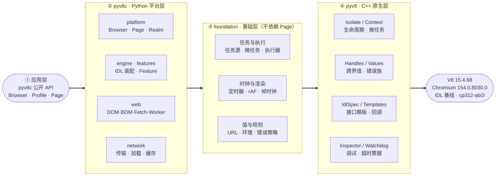
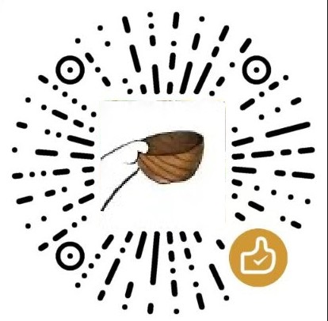

# pyv8c

**简体中文** | [English](docs/en/README.en.md)

pyv8c 是基于 V8 和 Python 的浏览器脚本运行框架。原生桥接由本仓库中的 `pyv8` 项目提供，Python 实现页面、DOM、Web API、资源加载、任务调度和调试接入。适合运行页面脚本、构造可重复的浏览器行为测试，以及通过本地 Chrome 对照完善 Web 能力。

框架提供常用 DOM 与事件、导航、iframe、Worker、Fetch、XMLHttpRequest、WebSocket、存储、部分样式与几何计算，以及 V8 Inspector。接口暴露由 Chromium IDL 和浏览器环境档案共同决定；**接口存在不代表功能完整实现**。

## 分层架构

从左到右是调用方向，从右到左是能力来源；①~④ 表示依赖层次。`pyv8c`（Python）实现页面、DOM、Web API、资源与任务调度，`pyv8`（C++ 扩展）提供 Isolate、Context、句柄与 IDL 原语，两者共同构成单个发行包。



## 安装

发行包将框架与 V8 引擎打包为单个 ABI3 wheel，CI 分别构建 Windows x64（`win_amd64`）、Linux x64（`linux_x86_64`）和 macOS arm64（`macosx_arm64`）版本。下载对应平台的构建产物后可执行 `py -m pip install 路径\pyv8c-版本-cp312-abi3-平台.whl`；它不依赖顶层 `pyv8` 发行包。发行包中的原生引擎也可单独使用：

```python
from pyv8c import pyv8

class Global:
    __v8_idl_spec__ = pyv8.IdlSpec(global_this=True)

context = pyv8.Context(Global())
try:
    print(context.exec_js("1 + 2"))
finally:
    context.close()
```

目前暂不发布到 PyPI。源码开发和发行包均使用 `pyv8c.pyv8` 入口。源码构建说明见[开发指南](docs/pyv8c/development.md#源码构建)。

要求启用 GIL 的 CPython 3.12 及以上，并能导入与当前解释器匹配的 `pyv8` 原生扩展。三个平台均由 CI 构建 wheel 并执行安装后冒烟与原生测试；CPython 3.12–3.15 的完整浏览器测试矩阵目前只在 Windows 上运行，其他平台仍需按各自环境验证。free-threaded CPython 暂不支持。

仓库包含 `pyv8/`（V8 绑定源码）和 `pyv8c/`（浏览器框架源码）。以下命令在仓库根目录使用 CPython 3.12 执行：

```powershell
python312 -m pip install -e ".[dev,reference]"
python312 -c "from pyv8c import pyv8; print(pyv8.__file__)"
```

源码开发前须配置 V8 构建目录，详见[原生项目文档](pyv8/README.md)。

默认 HTTP 和 WebSocket 引擎随基础依赖安装。`dev` 安装测试工具，`canvas` 提供 Pillow 绘图，`cronet` 提供可选网络引擎，`benchmark` 提供可选进程监测，`reference` 安装驱动本机 Chrome 的工具，不下载浏览器。原生扩展构建要求见 [pyv8 文档](pyv8/README.md)。

## 快速开始

```python
from pyv8c import Browser

browser = Browser(real_network=False)
try:
    page = browser.new_profile().new_page()
    page.set_content("<main id='app'>就绪</main>", url="https://example.test/")
    assert page.evaluate("document.querySelector('#app').textContent") == "就绪"
    page.evaluate("globalThis.answer = 0; setTimeout(() => answer = 42, 0)")
    page.wait_for("answer === 42", timeout=1)
    assert page.evaluate("answer") == 42
finally:
    browser.close()
```

默认 `Browser()` 开启真实网络，HTTP 使用 `curl_cffi`，WebSocket 使用 `websockets`。离线运行应显式设置 `real_network=False`，使用 `set_content()` 或资源加载器提供页面。

访问网站时，使用 `page.goto(url, wait_until="load", timeout=30)` 等待指定加载阶段。`run_until_idle()` 只等待当前可运行工作排空，不等待未来网络、定时器或 Worker 结果。`evaluate()` 不自动等待 Promise。

## 对象与执行模型

```text
Browser                         框架配置、接口装配和回调线程池
└─ Profile                      Cookie、网络后端、存储和 Blob URL
   └─ Page                      文档、导航、服务和资源所有权
      ├─ WindowExecutionGroup   owner 线程、Isolate 和帧时钟
      │  └─ Agent               任务源队列、显式微任务队列
      ├─ iframe Page            与所属页面共享执行组，使用独立 Realm
      └─ Worker                 独立线程、Isolate、Agent 和 Realm
```

独立 `new_page()` 创建独立执行组。同步跨 iframe 访问在同一 owner 线程切换 Context。活 JS 句柄只能在所属 owner 线程使用，原 Context 关闭后失效。关闭 Browser 会释放其 Profile、页面及相关资源；调用方应始终显式关闭。

## 文档

- [使用指南](docs/pyv8c/usage.md)：页面 API、等待、环境、网络入口与关闭。
- [架构设计](docs/pyv8c/architecture.md)：模块职责、执行所有权、绑定和生命周期。
- [开发指南](docs/pyv8c/development.md)：开发约定、测试、Chrome 对照和性能验证。
- [任务调度](docs/pyv8c/task-scheduling.md)、[资源加载](docs/pyv8c/resource-loading.md)、[网络传输](docs/pyv8c/network-transports.md)。
- [请求头](docs/pyv8c/request-headers.md)、[窗口与同源访问](docs/pyv8c/window-security.md)、[IDL 格式](docs/pyv8c/idl-format.md)。
- [调试器](docs/pyv8c/devtools.md)、[运行跟踪](docs/pyv8c/tracing.md)。

完整导航见 [文档索引](docs/README.md)；英文版见 [English documentation](docs/en/README.md)。

## 能力边界

pyv8c 不包含 Chromium 的完整渲染、进程和安全沙箱体系。样式、布局、图形、媒体、权限及设备 API 存在实现范围和环境差异；部分成员按基线暴露但使用占位实现。网络栈不是完整的 Fetch、HTTP 缓存或 Chrome 网络服务。

当前没有实现 OOPIF、完整 COOP/COEP、Origin-Agent-Cluster 和 `document.domain` 模型，也不提供完整 CDP Page、Network、DOM 域。不能以单个网站加载成功或接口数量衡量 Chrome 兼容程度。

具体实现与限制见 [Web 能力与实现范围](docs/pyv8c/web-capabilities.md)。

## 关于性能

> 我都是用 Python 了，你还问性能怎么样，这就不礼貌了。

**pyv8c 用 Python，是为了快速开发和快速验证**。补一个 Web API、改一处行为、拿本机 Chrome 做一次对照，都能立刻跑起来看结果；用运行期性能换开发和验证的迭代速度，是从一开始就做的选择。

优先保证的是浏览器行为的**可复现性**和可控的单次启动成本，而不是脚本吞吐或渲染速度。若你的场景追求极致执行速度，直接使用 V8 原生接口或原生方案更合适。

## 赞赏

> 如果 pyv8c 帮你省下了排查时间，不妨请我喝杯咖啡、抽根烟，或者给我续点 token。当然点个 star、提个 issue 一样让我开心。

| 微信赞赏码 | 支付宝赞赏码 |
| :---: | :---: |
|  |  |

## 许可与预期用途

本项目采用 [MIT License](LICENSE) 开源。V8、Chromium IDL 基线、ICU 数据及第三方依赖各自的许可与版权声明见 [第三方声明](THIRD_PARTY_NOTICES.md)。

**预期用途**：pyv8c 是用于复现浏览器脚本行为的研究与测试工具，面向获得授权的自动化测试、教学演示、Web 兼容性与行为对照研究。使用者应自行确认已取得目标站点或系统所有者的必要授权，并遵守其服务条款与所在司法辖区的适用法律（包括数据保护、网络安全与计算机信息系统相关规定）。

本项目不提供、也不接受以绕过第三方站点访问控制、规避反自动化措施或批量采集真实站点数据为唯一目的的支持请求（issue、讨论与 PR）。请勿在 issue、PR 或示例提交中附带真实站点的凭据、Cookie、挑战令牌、HAR 或其他私有数据。作者不对使用者的具体使用方式承担责任，也不认可任何未授权访问行为；如发现项目内容被用于此类用途，请通过 [安全政策](.github/SECURITY.md) 中的渠道告知，我们会评估并移除相关内容。

本节说明项目的预期用途与社区支持范围，**不构成对 MIT 许可证所授予权利的附加限制**。

## 商标与归属

pyv8c 不是 Google、Chromium、V8 或 Chrome 的官方项目，与之无关联、未获背书。Chrome / Chromium / V8 / Google 为各自权利人的商标或标识；仓库中的 IDL 基线与环境档案仅作为公开接口与运行时行为的事实性参考。上游 BSD-3-Clause 条款禁止借其名义为衍生产品背书，完整条款见 [第三方声明](THIRD_PARTY_NOTICES.md)。
