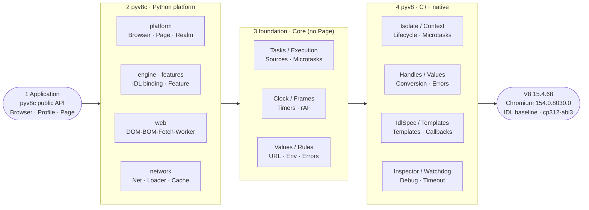

# pyv8c

[简体中文](../../README.md) | **English**

pyv8c is a browser scripting runtime built on V8 and Python. The native bridge comes from the `pyv8` sources in this repository, while Python implements pages, the DOM, Web APIs, resource loading, task scheduling and debugger integration. It is suited to running page scripts, building repeatable browser-behaviour tests, and closing Web-compatibility gaps against a local Chrome installation.

The framework provides common DOM APIs and events, navigation, iframes, Workers, Fetch, XMLHttpRequest, WebSocket, storage, partial styling and geometry, and the V8 Inspector. Which interfaces are exposed is determined jointly by the Chromium IDL baseline and a captured browser environment profile; **an interface being present does not mean it is fully implemented**.

## Layered Architecture

Left to right is the direction of calls; right to left is where the capabilities come from. 1-4 mark the dependency layers. `pyv8c` (Python) implements pages, the DOM, Web APIs, resources and task scheduling; `pyv8` (C++ extension) supplies Isolates, Contexts, handles and IDL primitives. Together they form a single distribution.



## Installation

The wheel packages the framework and the V8 engine into a single ABI3 artifact; CI builds Windows x64 (`win_amd64`), Linux x64 (`linux_x86_64`), and macOS arm64 (`macosx_arm64`). After downloading the artifact for your platform, install it with `py -m pip install PATH\TO\pyv8c-<version>-cp312-abi3-<platform>.whl`; it does not depend on a separate top-level `pyv8` distribution. The bundled native engine can also be used on its own:

```python
from pyv8c import pyv8

class Global:
    __v8_idl_spec__ = pyv8.IdlSpec(global_this=True)

context = pyv8.Context(Global())
try:
    print(context.exec_js("1 + 2"))
finally:
    context.close()
```

The project is not published on PyPI yet. Both source development and the wheel use the `pyv8c.pyv8` entry point. See the [development guide](pyv8c/development.md) for source build instructions.

CPython 3.12 or newer with the GIL enabled is required, and a matching `pyv8` native extension must be importable. CI builds wheels and runs post-install smoke and native tests on all three platforms; the full CPython 3.12-3.15 browser test matrix currently runs on Windows only, so other platforms still need verification in their own environments. Free-threaded CPython is not supported.

The repository contains `pyv8/` (V8 binding sources) and `pyv8c/` (browser framework sources). Run the following from the repository root with CPython 3.12:

```powershell
python312 -m pip install -e ".[dev,reference]"
python312 -c "from pyv8c import pyv8; print(pyv8.__file__)"
```

Before working from source, set up the V8 build directory as described in the [native project documentation](../../pyv8/README.md).

The default HTTP and WebSocket engines ship with the base dependencies. `dev` adds test tooling, `canvas` adds Pillow-backed drawing, `cronet` adds an optional network engine, `benchmark` adds optional process monitoring, and `reference` installs tooling that drives the Chrome already on your machine; no browser is downloaded. See the [pyv8 documentation](../../pyv8/README.md) for native extension build requirements.

## Quick Start

```python
from pyv8c import Browser

browser = Browser(real_network=False)
try:
    page = browser.new_profile().new_page()
    page.set_content("<main id='app'>ready</main>", url="https://example.test/")
    assert page.evaluate("document.querySelector('#app').textContent") == "ready"
    page.evaluate("globalThis.answer = 0; setTimeout(() => answer = 42, 0)")
    page.wait_for("answer === 42", timeout=1)
    assert page.evaluate("answer") == 42
finally:
    browser.close()
```

`Browser()` enables real network access by default, using `curl_cffi` for HTTP and `websockets` for WebSocket. For offline work, set `real_network=False` explicitly and supply pages with `set_content()` or a resource loader.

To visit a site, use `page.goto(url, wait_until="load", timeout=30)` to wait for a specific load phase. `run_until_idle()` only drains work that is currently runnable; it does not wait for future network activity, timers or Worker results. `evaluate()` does not automatically await Promises.

## Object and Execution Model

```text
Browser                         Framework config, interface assembly, callback pool
└─ Profile                      Cookies, network backends, storage, blob URLs
   └─ Page                      Document, navigation, services, resource ownership
      ├─ WindowExecutionGroup   Owner thread, Isolate, frame clock
      │  └─ Agent               Task-source queues, explicit microtask queue
      ├─ iframe Page            Shares the owner group, separate Realm
      └─ Worker                 Own thread, Isolate, Agent and Realm
```

Each independent `new_page()` creates its own execution group. Synchronous cross-iframe access switches Context on the same owner thread. Live JS handles may only be used on their owning thread and become invalid once the original Context is closed. Closing the Browser releases its Profiles, pages and related resources; callers should always close it explicitly.

## Documentation

The documentation is available in Chinese (primary) and English. The links below point to the English collection; the [Chinese documentation index](../README.md) has the originals.

- [Usage guide](pyv8c/usage.md): page APIs, waiting, environment, network entry points, shutdown.
- [Architecture](pyv8c/architecture.md): module responsibilities, execution ownership, bindings, lifecycle.
- [Development guide](pyv8c/development.md): conventions, tests, Chrome comparison, performance measurement.
- [Task scheduling](pyv8c/task-scheduling.md), [resource loading](pyv8c/resource-loading.md), [network transports](pyv8c/network-transports.md).
- [Request headers](pyv8c/request-headers.md), [window and same-origin access](pyv8c/window-security.md), [IDL format](pyv8c/idl-format.md).
- [Debugger](pyv8c/devtools.md), [runtime tracing](pyv8c/tracing.md).

Full navigation: [English documentation index](README.md).

## Scope and Limitations

pyv8c does not include Chromium's full rendering, process or security-sandbox architecture. Styling, layout, graphics, media, permissions and device APIs have partial coverage and environment-dependent behaviour; some members are exposed from the baseline but use placeholder implementations. The network stack is not a complete Fetch, HTTP cache or Chrome network service.

OOPIF, full COOP/COEP, Origin-Agent-Cluster and the `document.domain` model are not implemented, nor are the complete CDP Page, Network and DOM domains. Loading a single site successfully or counting exposed interfaces is not a measure of Chrome compatibility.

See [Web capabilities and implementation scope](pyv8c/web-capabilities.md) for concrete coverage and limits.

## On Performance

> I'm already using Python; asking how fast it runs is just impolite.

**pyv8c uses Python for fast development and fast verification.** Adding a Web API, changing one behaviour, or running a comparison against local Chrome can be executed and checked immediately. Trading runtime performance for iteration speed was a deliberate choice from day one.

The priority is **reproducible browser behaviour** and a predictable one-time startup cost, not script throughput or rendering speed. If your use case needs maximum execution speed, use the native V8 API or a native implementation instead.

## Sponsorship

> If pyv8c saved you debugging time, feel free to buy me a coffee, a cigarette, or a few more tokens. A star or an issue makes me just as happy, of course.

| WeChat | Alipay |
| :---: | :---: |
|  |  |

## License and Intended Use

pyv8c is released under the [MIT License](../../LICENSE). Licenses and copyright notices for V8, the Chromium IDL baseline, ICU data and third-party dependencies are collected in [THIRD_PARTY_NOTICES.md](../../THIRD_PARTY_NOTICES.md).

**Intended use**: pyv8c is a research and testing tool for reproducing browser scripting behaviour, aimed at authorised automated testing, teaching, Web compatibility and behaviour-comparison research. Users are responsible for obtaining any necessary authorisation from the owners of target sites or systems, and for complying with their terms of service and the applicable laws of their jurisdiction (including data protection, cybersecurity and computer information system regulations).

This project does not provide, and does not accept, support requests (issues, discussions or PRs) whose sole purpose is bypassing third-party access controls, circumventing anti-automation measures, or bulk-collecting data from real sites. Do not attach real-site credentials, cookies, challenge tokens, HAR files or other private data to issues, PRs or example submissions. The authors are not responsible for how the software is used and do not endorse unauthorised access; if you find project content being used for such purposes, please use the channel in the [security policy](../../.github/SECURITY.md) and we will review and remove it.

This section describes intended use and the scope of community support; it **does not add restrictions to the rights granted by the MIT License**.

## Trademarks and Attribution

pyv8c is not an official Google, Chromium, V8 or Chrome project, and is neither affiliated with nor endorsed by them. Chrome / Chromium / V8 / Google are trademarks or marks of their respective owners; the IDL baseline and environment profile in this repository are factual references to public interfaces and runtime behaviour only. The upstream BSD-3-Clause terms prohibit using their names to endorse derived products; see [THIRD_PARTY_NOTICES.md](../../THIRD_PARTY_NOTICES.md) for the full terms.
