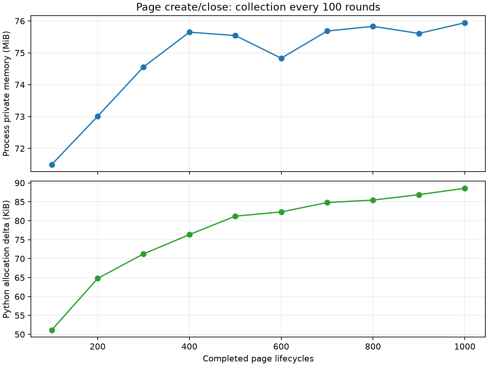

# Bridge refactor results

## Scope and status

Implemented the native lifecycle/resource refactor, CPython 3.12 Stable ABI,
vectorcall callbacks and accessors, default JS handles, explicit materialization,
passive trace fixes, and the corresponding pyv8c evaluation boundary changes.
Windows correctness, performance, memory and wheel checks passed locally.
Linux builds and Linux ASan/UBSan runs are **not verified** in this environment;
the complete cross-platform acceptance remains outstanding.

This historical measurement used V8 15.2.20.1; the current default is recorded in
`pyv8/V8_VERSION`. No compatibility layer for
`preserve_arguments` or `_to_python` was retained. See [bridge-kernel.md](bridge-kernel.md)
for interfaces, ownership, close semantics and reproduction commands.

## Build identity

- Date: 2026-09-18, Windows x64, MSVC 14.44, release `/O2 /GL /MT`.
- Baseline source: `pyv8` commit `45a19de56d12108dbe24b08ffa60359aecbabd1e`, from before the
  native binding and the browser framework were merged into one repository; that merge rewrote
  the history, so the hash no longer resolves.
- Baseline source/binary snapshots: `build/bridge-baseline-source.zip`,
  `build/bridge-baseline-pyv8c.zip`, `build/bridge-baseline.pyd`.
- Baseline binary SHA-256: `5d882a4adcb613abcddf87852c7292473bb1e3cd4177b66c30123fff1695339f`.
- Tested in-place binary SHA-256: `1d6e163081108337dad76f51f4f159ba7a39e4cb1d537305a3fd1b05fe5990bd`.
- Changes remain in the working trees. The revision field in the benchmark JSON
  identifies the parent commit; it does not imply the refactor was committed.
- Wheel: `dist/bridge/pyv8-2.1.2-cp312-abi3-win_amd64.whl`.
  Its clean build uses a separate output directory. Its metadata has the
  `cp312-abi3-win_amd64` tag; its only extension binary is `pyv8/_pyv8.pyd`.
  The repository's preexisting Linux `.so` was not rebuilt or distributed in it.

## Correctness

All tests from both projects were collected together, with the same in-place
binary and local Python sources on `PYTHONPATH`:

| Interpreter | Result | Duration |
| --- | --- | --- |
| CPython 3.12.9 | 916 passed, 35 subtests passed | 100.08 s |
| CPython 3.13.3 | 916 passed | 64.22 s |
| CPython 3.14.6 | 916 passed, 35 subtests passed | 65.57 s |

The 3.13 pytest installation does not report subtests separately. Each combined
run emitted two unknown-marker warnings because the native repository's pytest
configuration does not register pyv8c's `race` and `native` markers. No tests failed.
Native-only verification also passed: 332 tests and 35 subtests; pyv8c contributes
584 tests. Logs are in `build/bridge-python*-tests.log`.

Coverage includes both formerly failing passive trace cases, cyclic collection,
cross-context retention and invalidation, callback reentrant close, close races,
worker and inspector shutdown, origin checks, isolated error hooks and subprocess
shutdown without `--expose-gc`. New tests cover default handles, object identity
roundtrips without Proxy observation, explicit cyclic materialization, vectorcall
stack/heap argument boundaries and exception-state lifetime.

The extracted wheel was additionally loaded from `build/wheel-validation` on
all three interpreters, exercising native materialization and pyv8c page creation,
evaluation and close. These are wheel smoke checks, not a second full suite.

## Performance

`benchmarks/bridge.py` used five independent processes per version. Each workload
had five warmup batches and twenty measured batches per process. Results below
are medians of process medians, in milliseconds per batch. Both runs used
CPython 3.12.9 and the same machine, V8 and release compiler settings. The final
benchmark ran after builds and tests finished.

| Workload | Before ms | After ms | Time reduction |
| --- | ---: | ---: | ---: |
| Callback, 0 arguments | 1.584 | 0.822 | 48.1% |
| Callback, 1 argument | 2.060 | 0.910 | 55.8% |
| Callback, 4 arguments | 3.226 | 0.985 | 69.5% |
| Callback, 16 arguments | 7.578 | 1.503 | 80.2% |
| Bound method | 4.359 | 1.615 | 63.0% |
| Property getter | 2.746 | 1.484 | 46.0% |
| Property setter | 3.144 | 1.526 | 51.5% |
| Host object roundtrip | 3.735 | 1.947 | 47.9% |
| Exception | 215.297 | 210.696 | 2.1% |
| Trace enabled | 1.439 | 0.656 | 54.4% |
| Local DOM | 3.113 | 2.912 | 6.5% |
| Page create/close | 4.915 | 4.912 | 0.1% |

The first nine host workloads have a geometric mean time ratio of **0.4453**,
or **55.5% less elapsed time**, exceeding the 15% target. No individual measured
workload regressed by more than 5%. Page lifecycle is effectively unchanged.
These results describe these fixed workloads, not every application. The exception
case includes the existing error reporting overhead; it is not a pure throw benchmark.
Trace and DOM batches have 500 operations; other native batches have 2,000.
Page lifecycle batches each create and close one page.

Raw samples: [before.json](../../benchmarks/results/before.json),
[after.json](../../benchmarks/results/after.json). These are historical measurements.

## Memory

The independent `benchmarks/lifecycle.py` process warmed up with 20 pages, then
created and closed 1,000 pages with normal chrome installation. Every 100 rounds
it ran V8 LowMemoryNotification and Python GC three times. **Page, Window and
native Context live counts were zero at all ten checkpoints.** Page/Window use
weakrefs; native Context uses its GC-tracked identity because it has no weakrefs.
Observation references are cleared each batch to avoid their accumulating cost.

Private memory was 58.4 MiB before measurement, 71.5 MiB at round 100, and
75.9 MiB at round 1,000. From round 400 onward it ranged from 74.8 to 75.9 MiB,
without proportional growth with page count. Python traced allocation delta grew
from 51.1 KiB at round 100 to 88.6 KiB at round 1,000; the final 500 rounds added
about 7.4 KiB. These figures include the small accumulating report and runtime
caches. This run demonstrates released page ownership and a flattening private
memory curve; it does not assert that every byte or RSS returns to its initial value.

Raw data: [lifecycle-after.json](../../benchmarks/results/lifecycle-after.json).
The optional `benchmarks/plot_results.py` renders the memory curves with matplotlib.

## Remaining validation

No usable Linux execution environment or matching Linux V8 build was available
locally. `tools/validate_linux.sh` and `PYV8_SANITIZERS=address,undefined` provide
the bridge sanitizer build/run path, but have not been executed. Fully instrumented
V8 coverage also requires V8 built with the same sanitizer configuration.
The same-platform 3.12/3.13/3.14 ABI3 matrix is verified on Windows only.
